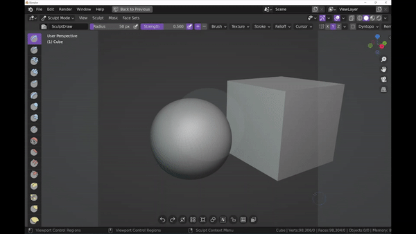
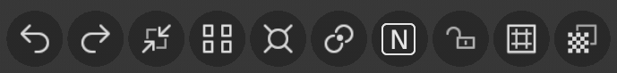
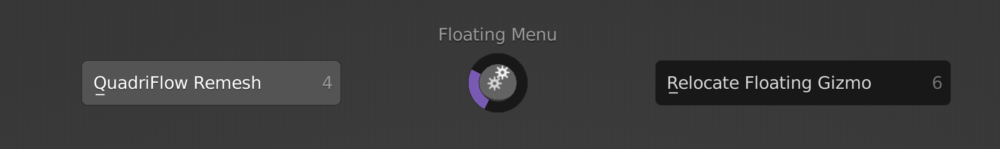

# TouchView

Pan, rotate, and zoom the viewport with touch or pen input. TouchView overlays configurable control zones and a customizable gizmo bar on top of Blender, making it comfortable to use without a keyboard or mouse.


## Features

- **Viewport touch control** - three configurable hot regions: drag the middle to pan, either edge to zoom, and the remaining space to rotate
- **Pen and finger together** - the pen keeps drawing while your finger (or mouse) controls the camera
- **Control-zone overlay** - a toggleable, colorable overlay showing each control region; fade it out or disable it once you know the layout
- **Swap Pan/Rotate** - swap the pan and rotate regions; with rotation locked, pan anywhere between the zoom edges
- **Custom double-tap** - finger or click double-tap triggers Transfer Mode, Toggle Touch Control, Toggle Local View, or Toggle Full-screen; the pen never triggers it while drawing
- **Custom on-screen buttons** - Undo/Redo, Fullscreen, Quad-view, Recenter, Rotation Center, N-panel, Rotation Lock, Topology Control, and Sculpt Brush Dynamics, each toggleable from the overlay menu
- **Topology control** - retopology tools in Sculpt Mode; switches to subdivision-level controls when the object has a Multires modifier, with a configurable subdivision limit
- **Sculpt brush dynamics** - brush size and strength from the viewport in sculpt, paint, Grease Pencil and Curves Sculpt modes; tooltips on every on-screen button
- **Floating action menu** - assign up to 8 commands per edit mode and drag it anywhere; disable it if you don't need it



### Roadmap

- **Better 3D gizmos for edit mode** - replace the icon bar in Edit Mode with interactive 3D gizmos so extrude, bevel, loop cut and similar tools are reachable from the viewport
- **Control gizmo cycle** - let the on-screen control button flip through the object transform gizmos and the sculpt-mode gizmos (mask, face sets, and so on)

## Installation

1. Download the latest release zip (`touch_view_vX.Y.Z.zip`) from the [releases page](https://github.com/nendotools/touchview/releases).
2. In Blender, open `Edit > Preferences > Add-ons` (or `Get Extensions` on Blender 4.2+), click the top-right dropdown, choose `Install from Disk...`, select the zip and enable **Touch Viewport**.

> **Not showing up or no input?** Search the Add-ons list for **Touch Viewport** (the add-on name and sidebar category differ) and make sure it is enabled. On Linux, run Blender through X11/XWayland (`WAYLAND_DISPLAY= blender`) - Blender's native Wayland backend does not forward tablet or touch events to add-ons.

## Usage

TouchView overlays three control regions on the viewport. By default the pen draws while your finger or mouse drives the camera; change the routing with **Input Mode** in the preferences. Settings live in **3D Viewport > Sidebar (N-Panel) > Touchview**.



Every on-screen button can be toggled on or off from the overlay menu.



The floating action menu holds up to 8 custom commands per edit mode and can be dragged anywhere in the viewport.

### Shortcuts

| Input         | Action        | Description                                                                |
| ------------- | ------------- | -------------------------------------------------------------------------- |
| `Alt + T`     | Toggle Touch  | Enable or disable the control zones                                        |
| `Double-tap`  | Custom action | Finger or click only: Transfer Mode, Toggle Touch, Local View, Full-screen |
| `Right-click` | Custom action | Configurable viewport action, triggered by mouse or pen                    |

### Settings

| Setting                | Description                                                               |
| ---------------------- | ------------------------------------------------------------------------- |
| **Input Mode**         | `Full`, `Pen`, or `Touch` - which devices drive the camera.               |
| **Lazy Mode**          | Control the camera when the touch does not land on the active object.     |
| **Control Zones**      | Enable the zones, show or fade the overlay, set colors, width and radius. |
| **Swap Pan/Rotate**    | Swap the pan and rotate regions.                                          |
| **Header Toggle**      | Position of the touch toggle in the Image and Node editor headers.        |
| **Menu Style**         | `Floating Radial` or `Fixed Bar`, with position, scale and padding.       |
| **Right/Double Click** | Action triggered by right-click and by double-tap.                        |
| **Subdivision Limit**  | Maximum subdivision levels offered by the topology controls.              |
| **Floating Menu**      | Show the draggable per-mode action menu.                                  |

## Building from source

The release zip is produced by Blender's own extension builder, which reads `blender_manifest.toml` for the version and the files to exclude:

```sh
make build
```

This writes `releases/touch_view_vX.Y.Z.zip`. If Blender isn't on your `PATH`, point `BLENDER` at the executable:

```sh
make build BLENDER="/path/to/blender"
```

## Links

- [Documentation](https://github.com/nendotools/touchview)
- [Report a Bug / Support](https://github.com/nendotools/touchview/issues)
- [Gumroad](https://nendo.gumroad.com/l/touchview)

## Changelog

See [CHANGELOG.md](CHANGELOG.md), or press `F3` in Blender and search **Changelog** to open the in-app popup.

## License

GPL-3.0-or-later - see [LICENSE](LICENSE).
